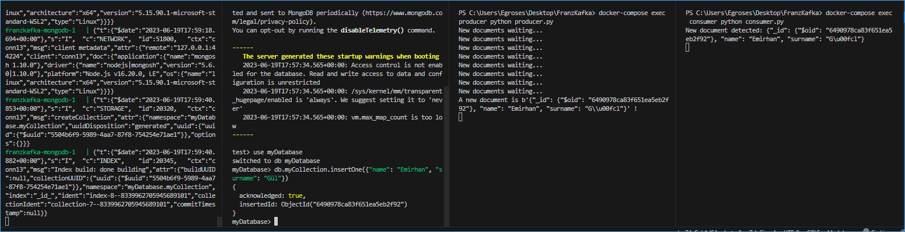
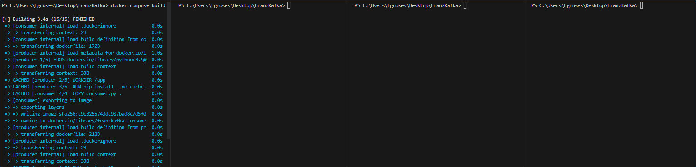
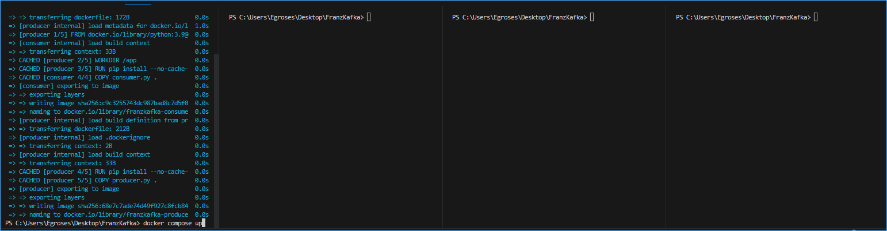
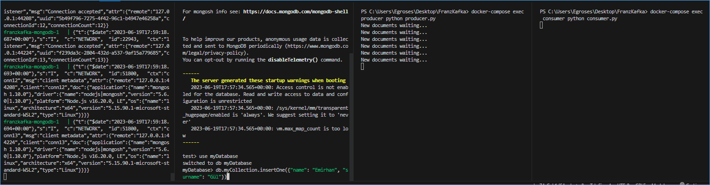

# FranzKafka

Apache Kafka ile basit bir değişiklik yakalama (CDC) denemesi. MongoDB'ye yeni bir belge eklendiğinde bunu Kafka üzerinden başka bir servise ileten küçük bir veri hattı; her parça Docker Compose ile ayağa kalkıyor.



## Neden?

Bir veritabanında olan değişikliği, o veritabanına bağlı olmayan başka bir servise mesaj kuyruğu üzerinden iletmenin temelini görmek için yapıldı. Haziran 2023'te Kafka, Docker ve MongoDB'yi birlikte kullanma pratiği olarak hazırlandı.

## Nasıl çalışıyor

```
MongoDB  →  producer  →  Kafka (myTopic)  →  consumer
```

- **producer:** 10 saniyede bir MongoDB'deki koleksiyonun en son eklenen belgesine bakıyor. Belge bir öncekinden farklıysa JSON olarak Kafka'daki `myTopic` konusuna gönderiyor.
- **consumer:** `myTopic` konusunu dinliyor, gelen her belgeyi ekrana yazıyor.
- **Docker Compose:** MongoDB, Kafka, producer ve consumer servislerini birlikte başlatıyor.

## Çalıştırma

```bash
docker compose build
docker compose up
docker compose exec producer python producer.py
docker compose exec consumer python consumer.py
```

Sonra MongoDB'ye bir belge eklenip consumer ekranında görünmesi bekleniyor:

```bash
docker compose exec mongodb mongosh
use myDatabase
db.myCollection.insertOne({"ad": "Deneme", "soyad": "Kayıt"})
```

| Derleme | Çalıştırma |
|---|---|
|  |  |
| **Producer ve consumer** | **Belge ekleme** |
|  |  |

## Teknik

| | |
|---|---|
| **Dil** | Python (`kafka-python`, `pymongo`) |
| **Altyapı** | Apache Kafka, MongoDB, Docker Compose |
| **Kod** | `producer/producer.py`, `consumer/consumer.py`, `docker-compose.yaml` |
